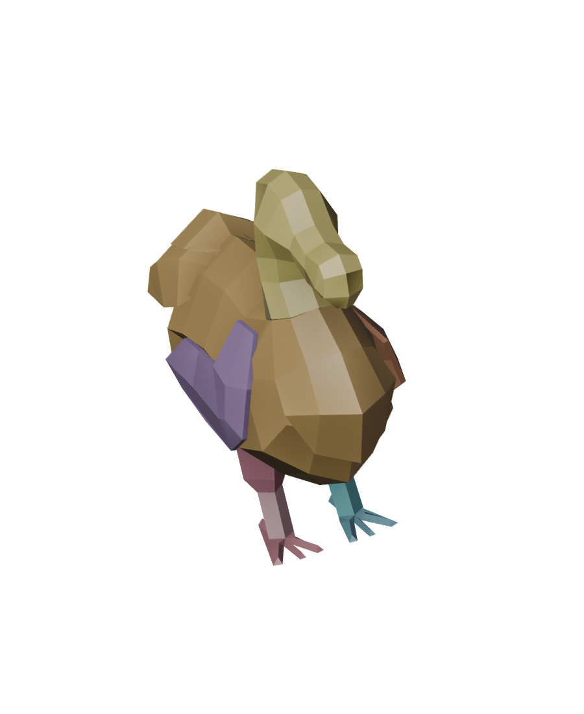

# DonPiñaton

Plantillas a escala real para armar piñatas huecas de papel y cartón, a partir de un modelo 3D. El primer objeto es un dodo de 1 m de alto.

La carpeta local se llama DonPiñaton. En GitHub el repositorio quedó como [CuevazaArt/DonPi-aton](https://github.com/CuevazaArt/DonPi-aton): el nombre con eñe no se pudo conservar en la URL y el guion ocupa su lugar. El trabajo vive en las dos rutas.

El flujo común genera la plantilla así: el protocolo elige la disolución que conserva la silueta, la malla no se colapsa, las solapas de pegado salen en triángulo, el desdoble va a lámina de cartón a escala real y la impresión acomoda las islas en doble carta. La isla que cabe sale entera. La que no cabe se parte en mosaico.

## Para armar el dodo

Imprime este archivo al 100 %, en doble carta (279 × 432 mm):

`salida/dodo/carton_30grados_paleta/mosaico_doble_carta.pdf`

Son 74 hojas y 17 piezas de corte. La primera hoja trae un cuadrado cuyo interior tiene que medir 100 mm. El armado está en [el manual](docs/MANUAL.md). Papel, cartón y pegamento están en [materiales](docs/MATERIALES.md).

## Para armar el jabalí

Imprime este archivo al 100 %, en doble carta:

`salida/jabali/carton_30grados_paleta_ceja/mosaico_doble_carta.pdf`

Son 57 hojas y 25 piezas de corte. El jabalí queda a 50 cm de alto. Ese archivo se partió con una isla por hoja. Las solapas son triángulos: dos cortes, y la base es el doblez. El modelo es «boar block anim» por [blam](https://sketchfab.com/Blam577895), [CC BY 4.0](http://creativecommons.org/licenses/by/4.0/). El detalle está en [créditos](docs/CREDITOS.md).

El de 40 cm, con la misma paleta y ya acomodado, está en `salida/jabali/40cm_carton_30grados_paleta_ceja/mosaico_doble_carta.pdf`. Son 26 hojas. Las islas que caben comparten hoja y las cinco que no caben siguen en mosaico.

## Ejemplo

El ave de origen, a 1 m, con un color plano por pieza para la inspección. A la derecha, la misma silueta tras disolver aristas a 30°. Abajo, el atlas recoloreado que se hornea en la plantilla.

| Original | Disolución a 30° |
| --- | --- |
|  |  |

«dodo block anim» por [blam](https://sketchfab.com/Blam577895), bajo [CC BY 4.0](http://creativecommons.org/licenses/by/4.0/). Obra original en [Sketchfab](https://sketchfab.com/3d-models/dodo-block-anim-6b63321a76f241a3899193f129e92f7d). DonPiñaton la modificó: escala de 1 m, simplificación, paleta y plantilla de papel. blam y Sketchfab no patrocinan este repositorio. El detalle está en [créditos](docs/CREDITOS.md).

## Documentos

| Documento | Para qué |
| --- | --- |
| [docs/FLUJO.md](docs/FLUJO.md) | Cómo se atacó cada complicación, de la malla al mosaico |
| [docs/MANUAL.md](docs/MANUAL.md) | Imprimir, cuadrar, pegar, cortar y armar |
| [docs/EJECUCION.md](docs/EJECUCION.md) | Comandos para volver a generar una plantilla |
| [docs/MATERIALES.md](docs/MATERIALES.md) | Papel, cartón, cinta y pegamento |
| [docs/CREDITOS.md](docs/CREDITOS.md) | Autor, licencia CC BY 4.0 y cambios sobre el modelo |

## Qué hay en el repositorio

- `scripts/generar_plantilla_dodo.py` escala el modelo, simplifica la malla y desdobla las piezas. `--ceja-triangular` deja la malla como está y convierte cada solapa de pegado en triángulo.
- `salida/jabali/` y `modelos/jabali/` guardan el jabalí de 50 cm hecho con ese flujo.
- `scripts/io_export_paper_model.py` es el desdoblador. Pepakura Designer 6.3.9 está instalado para revisar a mano; este complemento hace el desdoble por script, a escala 1:1.
- `scripts/mosaico_doble.py` acomoda las islas en doble carta. Las que caben comparten hoja. Las que no, se parten con solape y claves de esquina.
- `scripts/protocolo_silueta.py` compara siluetas y elige hasta dónde se puede simplificar.
- `salida/dodo/` guarda las plantillas ya generadas. Cada carpeta trae su `LEEME.txt`.
- `modelos/dodo/` guarda la malla de 1 m en OBJ y Blend, ya horneada en metros.

El GLB de origen no está en el repositorio. En esta computadora vive en `C:\Users\lexar\Downloads\dodo3d\dodo_block_anim.glb`.

## Etiqueta

`v0.1.0` es el dodo de 30°, con paleta, desdoblado en lámina de cartón y mosaicado a doble carta. Sus solapas siguen en trapecio.

`v0.2.0` fija el flujo común: la malla respeta la disolución que aprueba el protocolo, y las solapas de pegado salen en triángulo. El jabalí de 50 cm es la plantilla hecha con ese flujo.
